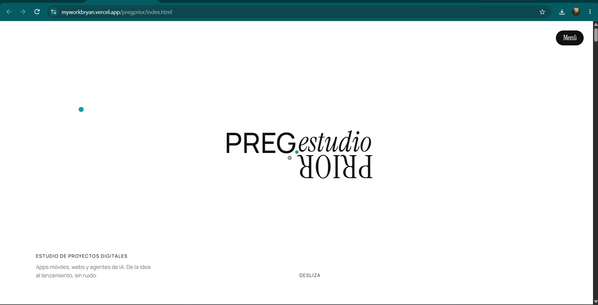
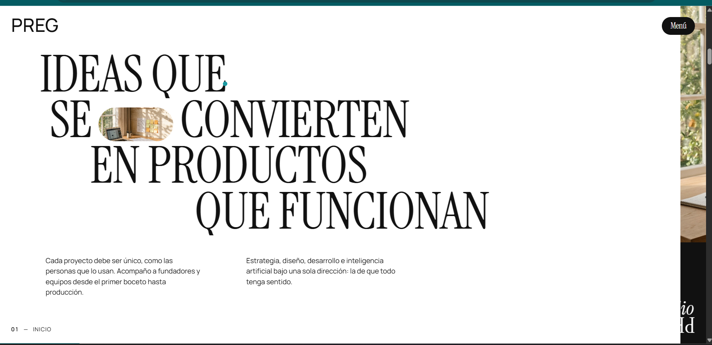
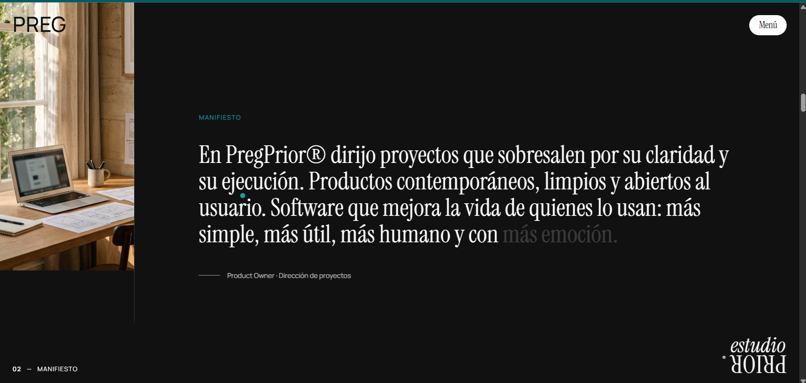
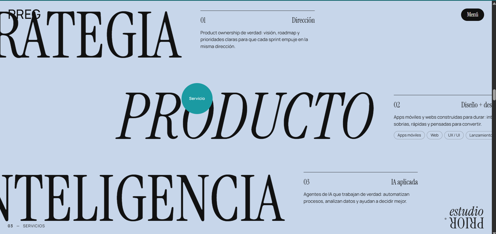

# PregPrior — Estudio de proyectos digitales

Marca y sitio de posicionamiento para un estudio que dirige proyectos de producto digital:
apps móviles, webs y agentes de inteligencia artificial.

| | |
|---|---|
| **Integrante** | Bryan Kevin Quispe Puma |
| **Rol en el proyecto** | Dirección del estudio: posicionamiento, definición de la oferta, identidad y sitio |
| **Contexto** | Iniciativa propia en fase de lanzamiento |
| **Estado** | Sitio publicado · sin casos de cliente todavía |

---

## 1. El problema

Un profesional que dirige producto compite por encargos contra dos perfiles más fáciles de
entender: el desarrollador, al que se contrata por lo que construye, y la agencia, a la que
se contrata por su tamaño. La dirección de producto queda en medio, difícil de explicar en
una conversación de venta.

El riesgo concreto es el encargo mal planteado. Un cliente que no distingue estrategia de
ejecución pide una aplicación cuando lo que necesita es decidir qué construir primero, y
el proyecto arranca ya torcido.

El problema que resuelve esta marca no es visual. Es **explicar qué se vende** antes de
que el cliente lo pida mal.

---

## 2. El análisis

La decisión central es qué posición ocupar. El estudio no se presenta como taller de
desarrollo ni como agencia, sino como una sola dirección que atraviesa estrategia, diseño,
desarrollo e inteligencia artificial. Esa es la respuesta al problema anterior: si el valor
está en la coherencia entre decisiones, la oferta tiene que mostrarse unificada y no como
un catálogo de capacidades sueltas.

De ahí se derivan las decisiones del sitio:

- **La oferta se articula en tres bloques, no en una lista de servicios.** Dirección,
  producto e inteligencia aplicada. Cada uno responde a un tipo distinto de encargo, y
  juntos explican el recorrido completo de un proyecto.
- **El manifiesto va en primera persona.** Es una decisión de posicionamiento: frente a una
  agencia anónima, el estudio compite ofreciendo un interlocutor con nombre.
- **El recorrido está numerado.** Inicio, manifiesto, servicios. El visitante sabe en qué
  parte del argumento está, porque el sitio es un argumento antes que un catálogo.
- **La promesa es la sobriedad.** El propio sitio tiene que demostrar lo que ofrece:
  interfaces limpias, rápidas y sin ruido. Un estudio que promete claridad y publica una
  página recargada se desmiente solo.

**Herramientas y metodologías aplicadas**

| Herramienta / método | Para qué se usó |
|---|---|
| Definición de posicionamiento | Decidir contra quién se compite y con qué argumento |
| Estructura de oferta en tres bloques | Que el cliente identifique su tipo de encargo |
| Diseño de identidad y tipografía | Sostener visualmente la promesa de claridad |
| Desarrollo y publicación del sitio | Llevar la propuesta a algo visitable |

---

## 3. La propuesta

Tres frentes de trabajo, cada uno dirigido a un encargo distinto:

| Frente | Qué ofrece |
|---|---|
| **Dirección** | Product ownership: visión, hoja de ruta y prioridades, para que cada ciclo de trabajo avance en la misma dirección |
| **Diseño y desarrollo** | Apps móviles y webs construidas para durar, con interfaces sobrias y orientadas a convertir |
| **IA aplicada** | Agentes que automatizan procesos, analizan datos y apoyan la decisión |

El eje que los une es explícito en la propuesta: estrategia, diseño, desarrollo e
inteligencia artificial bajo una sola dirección.

---

## 4. Resultados

El sitio está publicado y recorrible. No hay métricas de captación ni casos de cliente,
porque el estudio está en fase de lanzamiento.

Lo que esta evidencia demuestra es el trabajo previo a vender: definir una posición,
estructurar una oferta y construir el soporte que la comunica.

---

## 5. Limitaciones

- **Sin casos que mostrar.** Un estudio se evalúa por su portafolio, y aquí todavía no hay
  proyectos propios publicados. Es la carencia más visible y la que primero habría que
  cubrir.
- **Sin dominio propio.** El sitio vive en un subdominio de la plataforma de despliegue.
  Para una marca que vende criterio, la dirección es parte del argumento.
- **La propuesta no está validada en el mercado.** El posicionamiento es una hipótesis
  razonada; solo los encargos que llegue a recibir dirán si se entiende.
- **Promesa amplia para un equipo pequeño.** Estrategia, diseño, desarrollo e IA es un
  alcance que exige mostrar resultados en los cuatro frentes para resultar creíble.

---

## 6. Capturas

*Portada. La marca lleva "PRIOR" invertido bajo "PREG", una decisión gráfica que convierte
el nombre en una imagen reconocible. Debajo, la propuesta en una línea: apps móviles, webs
y agentes de IA, de la idea al lanzamiento.*

*Sección de inicio. El titular define el oficio en una frase —ideas que se convierten en
productos que funcionan— y las dos columnas separan el argumento en dos partes: el
acompañamiento desde el boceto hasta producción, y la coherencia entre las cuatro
disciplinas.*

*Manifiesto. En primera persona y firmado como Product Owner. La decisión de posicionamiento
está aquí: frente a una agencia anónima, un interlocutor con nombre que responde por el
criterio del proyecto.*

*Servicios. Estrategia, producto e inteligencia, numerados y con su descripción al costado.
Cada bloque corresponde a un tipo de encargo distinto, de modo que el cliente se reconozca
en uno antes de escribir.*
