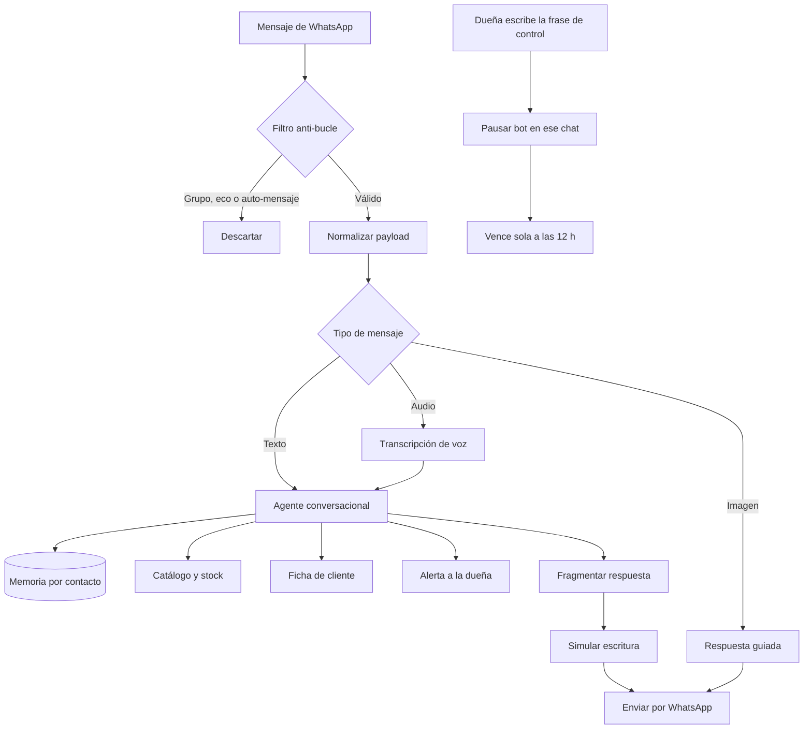

# Asistente comercial de WhatsApp — Agrovicman

Automatización de atención y venta por WhatsApp para un productor de café de especialidad
y cacao de Quillabamba (La Convención, Cusco), con base comercial en Cusco.

| | |
|---|---|
| **Integrante** | <TU NOMBRE> |
| **Rol en el proyecto** | <QUÉ HICISTE TÚ: análisis, diseño del flujo, reglas de negocio, implementación> |
| **Contexto** | Cliente real · Hackathon <NOMBRE>, <AÑO> — **segundo puesto** |
| **Estado** | Construido y funcional. No desplegado en producción |
| **Naturaleza de los datos** | Datos reales del negocio. Este documento no publica ninguno |
| **Demo en video** | <PENDIENTE: pegar enlace> |

---

## 1. El problema

El negocio vende café de especialidad y derivados de cacao por WhatsApp, atendido
personalmente por la dueña. Ese canal concentra la venta y también el cuello de botella:

- **Atención secuencial.** Una sola persona responde todas las conversaciones, mientras
  atiende producción, tostado y despacho. Las consultas fuera de horario se contestan al
  día siguiente, cuando el cliente ya compró en otro lado.
- **Precios inconsistentes.** El catálogo tiene variedades (cidra, geisha, bourbon,
  típica, catimor) y presentaciones distintas, con precio de lista y piso de negociación
  propios. Responder de memoria produce diferencias entre clientes y ventas bajo margen.
- **Stock en dos ubicaciones.** Parte del inventario está en Cusco y parte en Quillabamba.
  Prometer entrega inmediata de algo que está a ocho horas de distancia genera un
  incumplimiento, no una venta.
- **Sin registro.** Las conversaciones no dejaban rastro consultable: no había forma de
  saber quién preguntó qué, ni hacer seguimiento a una cotización.

El problema de fondo no era la velocidad de respuesta. Era que **el conocimiento comercial
vivía en la cabeza de una persona** y no podía atender dos conversaciones a la vez.

---

## 2. El análisis

El trabajo previo consistió en levantar cómo vendía realmente el negocio, no cómo
debería vender:

- **Observación del canal real.** Revisión de conversaciones existentes para extraer el
  tono de la casa, las frases propias del negocio y la secuencia con que se cierra una
  venta. El asistente reproduce ese registro; no impone uno corporativo.
- **Mapeo del catálogo.** Identificación de variedades, presentaciones, sinónimos que usan
  los clientes (*geisha / geyshia / geysha*, *cidra / sidra*, *pasta de cacao / chocolate
  de taza*) y qué productos no son de especialidad.
- **Reglas de precio.** Para cada código: precio de lista, precio mínimo y ubicación del
  stock. Esto definió el margen de negociación permitido.
- **Puntos de escalamiento.** Dónde el sistema *no* debe decidir: pedidos por volumen
  fuera de rango, producto sin stock confirmado, consultas que no resuelve el catálogo.

**Herramientas y metodologías aplicadas**

| Herramienta / método | Para qué la usé |
|---|---|
| Análisis del canal de venta existente | Extraer tono, objeciones frecuentes y secuencia de cierre |
| Modelado del catálogo como fuente única | Eliminar precios de memoria y fijar el piso de negociación |
| Diseño de flujo conversacional por roles | Separar el comportamiento ante cliente y ante la dueña |
| n8n (automatización de flujos) | Orquestar el proceso completo, 37 nodos |
| Agente LLM con herramientas | Decidir cuándo consultar el catálogo, registrar o escalar |
| Transcripción de voz | Atender notas de audio, el formato dominante del canal |

---

## 3. La solución

Un asistente que atiende el WhatsApp del negocio, consulta el inventario en tiempo real y
sabe cuándo callarse y pasarle la conversación a la dueña.

**Propuesta de valor:** para un productor que vende por WhatsApp y no puede atender dos
conversaciones a la vez, esto responde al instante con el precio correcto y escala a la
dueña cuando hace falta — a diferencia de un chatbot de respuestas fijas, que improvisa
precios y no conoce el stock.

### Arquitectura

### Decisiones de diseño que sostienen el negocio

**El catálogo es la única fuente de precios.** El agente tiene prohibido responder un
precio de memoria. Antes de cada cifra consulta la hoja de inventario. Si la consulta
falla o el producto no aparece, no improvisa: responde que lo confirma y avisa a la dueña.
Esto elimina la causa raíz de la inconsistencia, en lugar de pedirle al modelo que sea
cuidadoso.

**Piso de negociación duro.** Puede ceder una sola vez, hasta el precio mínimo definido
para ese código, y solo si el cliente pide rebaja o compra por volumen. Por debajo de ese
piso no negocia: sostiene el precio con la frase que usa la casa. El margen deja de
depender del criterio de quien atiende.

**Dos modos según quién escribe.** Ante un cliente actúa como vendedor. Ante la dueña
actúa como asistente administrativo: consulta clientes, reporta stock y gestiona productos,
sin tratarla como prospecto ni registrarla en la base.

**La ubicación del stock cambia la promesa.** Si el producto está en Quillabamba y el
cliente en Cusco, no promete entrega inmediata. Un sistema que ignora la logística genera
incumplimientos que cuestan más que la venta.

**Honestidad de producto como regla.** Si piden el café más barato, explica que no es de
especialidad y recomienda la variedad pura. Es la posición del negocio, no una táctica de
venta, y está escrita como regla inquebrantable.

**Control manual con vencimiento.** La dueña recupera cualquier conversación escribiendo
una frase dentro del chat; el asistente se calla solo para ese contacto y le confirma.
La pausa expira sola a las 12 horas, de modo que un olvido no deja el canal mudo.

**Respuesta fragmentada con simulación de escritura.** La salida se parte en mensajes
cortos con pausas, como escribe una persona. Un párrafo largo delata al sistema y rompe
la conversación.

---

## 4. Indicadores y resultados

### Resultado obtenido

**Segundo puesto** en <NOMBRE DE LA HACKATHON>, <AÑO>, con este proyecto. El sistema quedó
construido y funcional; no llegó a operar en producción con el negocio.

### Validación funcional

| Indicador | Resultado | Cómo se midió |
|---|---|---|
| Cobertura del catálogo | <N> variedades y presentaciones | Conteo sobre la hoja de inventario |
| Precios inventados en pruebas | 0 | <N> consultas de precio contra el flujo completo |
| Reconocimiento de sinónimos | <N> variantes resueltas | Pruebas con las formas que usan los clientes |
| Mensajes de audio transcritos | <N> pruebas | Notas de voz reales del canal |
| Disponibilidad de atención | 24 h | Frente a atención manual en horario de la dueña |

> **Pendiente de completar.** Reemplazar `<N>` con las cifras reales de las pruebas. Si
> alguna no se midió, borrar la fila: una tabla honesta y corta vale más que una completa
> y adivinada.

### Lo que no se puede afirmar

No hay métricas de conversión, ticket promedio ni tiempo de respuesta en operación real,
porque el sistema no se desplegó. Los indicadores anteriores son de validación funcional,
no de impacto comercial.

---

## 5. Limitaciones y qué haría distinto

- **Sin datos de producción, el diseño no está validado donde importa.** Las reglas de
  negociación y escalamiento son razonables sobre el papel; solo el uso real diría si el
  piso de precio es el correcto o si los clientes abandonan antes de llegar ahí.
- **La hoja de cálculo como base de datos tiene techo.** Resuelve bien el arranque y la
  dueña puede editarla sin ayuda, que era el requisito. Con más volumen o más de un
  operador, la concurrencia se vuelve un problema.
- **El escalamiento depende de que el modelo reconozca su propia incertidumbre.** Es el
  punto más frágil del diseño. Hoy se apoya en reglas explícitas; mediría cuántas veces
  debió escalar y no lo hizo.
- **Imagen resuelta con respuesta fija.** Un cliente que manda foto de un producto recibe
  una respuesta guiada, no un reconocimiento real. Es una deuda conocida.

---

## 6. Demo

<PENDIENTE: enlace al video>

## 7. Capturas

<PENDIENTE: agregar capturas en `capturas/` y enlazarlas aquí>

---

## Nota sobre el contenido publicado

Este documento describe la arquitectura y las decisiones de diseño. No incluye
credenciales, endpoints, identificadores de hojas de cálculo, números de contacto, precios
del negocio ni el prompt operativo del asistente.
