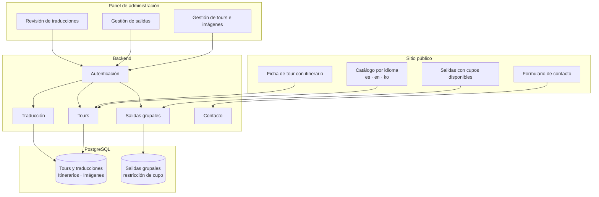

# Plataforma de tours y salidas grupales — ArsaTours

Sitio multilingüe y panel de gestión para ArsaTours, agencia de turismo receptivo en
Cusco: catálogo de tours, salidas grupales con cupos y traducción asistida del contenido.

| | |
|---|---|
| **Integrante** | Daniel Stip Sarmiento Valdez |
| **Rol en el proyecto** | Arquitectura, backend, modelo de datos y frontend |
| **Contexto** | Cliente real · ArsaTours, agencia de turismo receptivo en Cusco |
| **Periodo** | Julio 2026 — noviembre 2026 |
| **Naturaleza de los datos** | Datos reales del negocio. Este documento no publica ninguno |

---

## 1. El problema

ArsaTours vende turismo receptivo en Cusco a un público que no habla español y que compra
antes de viajar. Eso impone dos exigencias que el negocio no estaba cubriendo.

**El contenido tiene que existir en varios idiomas, y mantenerse.** Un tour no es una
ficha corta: tiene descripción, itinerario día por día, qué incluye y qué no. Traducir eso
a mano para cada idioma, y volver a hacerlo cada vez que cambia un precio o se ajusta una
ruta, es trabajo que no se hace. El resultado habitual es una versión en español cuidada y
unas traducciones desactualizadas que contradicen a la original.

**Las salidas grupales se venden sobre un cupo limitado.** Un tour compartido tiene plazas
finitas en una fecha concreta. Si el sistema permite vender la plaza 13 de un bus de 12,
el problema no aparece en la pantalla: aparece en el punto de encuentro, con un turista
que pagó y no sube.

A eso se suma que quien administra el contenido no es técnico. Si publicar un tour exige
tocar código, la agencia depende de un tercero para cada cambio de temporada.

---

## 2. El análisis

El trabajo partió de dos decisiones que condicionan todo lo demás:

**Dónde vive la regla del cupo.** Una validación en el formulario es cómoda y no sirve:
no protege de una condición de carrera entre dos reservas simultáneas, ni de una
corrección manual desde el panel, ni de un error en el propio código. La regla tiene que
estar donde ninguna de esas vías pueda saltarla.

**Qué parte de la traducción puede automatizarse.** Traducir por completo a máquina y
publicar sin revisión es arriesgado para contenido comercial. Pero obligar a traducir
desde cero a mano garantiza que no se mantenga. La respuesta no es elegir uno de los dos
extremos.

**Herramientas y metodologías aplicadas**

| Herramienta / método | Para qué se usó |
|---|---|
| NestJS y Prisma sobre PostgreSQL | Backend modular y modelo de datos versionado |
| Restricciones a nivel de base de datos | Hacer imposible el sobrecupo, no solo improbable |
| Transacciones | Que una traducción se guarde completa o no se guarde |
| Next.js con TypeScript y Tailwind | Sitio público y panel de administración |
| Enrutamiento por idioma | Una URL propia por idioma, indexable por buscadores |
| Modelo de lenguaje vía API | Generar el borrador de traducción, revisable antes de publicar |
| Autenticación JWT con guardas por ruta | Separar el catálogo público de la administración |

---

## 3. La solución

**Propuesta de valor:** para una agencia que vende tours a viajeros extranjeros antes de
que lleguen al país, esto mantiene el catálogo al día en tres idiomas y garantiza que un
cupo nunca se venda dos veces — a diferencia de un sitio tradicional, donde la traducción
se desactualiza y el control de plazas vive en una hoja aparte.

### Arquitectura

### Decisiones de diseño con razón de negocio

**El cupo se protege en la base de datos, no en el formulario.** Una restricción declara
que las plazas disponibles nunca pueden ser negativas ni superar el total de la salida.
*Vender una plaza que no existe deja de ser posible por cualquier vía* — reserva
simultánea, edición manual desde el panel o error de código. El control vive por debajo de
la aplicación, donde ningún camino lo rodea.

**Traducción asistida, no automática.** El sistema genera el borrador en inglés y coreano
—título, descripción, itinerario, inclusiones y exclusiones— y lo deja editable en el
panel antes de publicar. *La agencia mantiene tres idiomas sin pagar traducción completa
en cada cambio, y conserva la última palabra sobre lo que se publica.* Automatizar el
borrador y no la decisión.

**La traducción se guarda en una transacción.** Un tour tiene itinerario de varios días;
guardar la descripción y fallar a mitad del itinerario dejaría la ficha en coreano a
medias, peor que no tenerla. *O se guarda completa, o no se guarda.*

**Un idioma, una URL.** Cada idioma tiene su propia ruta en lugar de un selector que
cambia el texto en la misma dirección. *El contenido es indexable por buscadores y
compartible*, que para una agencia que depende de la búsqueda orgánica desde el extranjero
es la diferencia entre existir y no existir.

**Coreano como tercer idioma.** No es una decisión técnica sino comercial: responde a un
mercado emisor concreto hacia Cusco. El sistema admite agregar idiomas sin rehacer el
modelo, porque las traducciones son registros relacionados y no columnas fijas.

**Cambio de contraseña con registro de fecha.** El panel rastrea cuándo se cambió la
credencial del administrador, de modo que una cuenta con contraseña inicial sin rotar sea
detectable.

---

## 4. Resultados

| Indicador | Valor |
|---|---|
| Idiomas soportados | 3 — español, inglés y coreano |
| Entidades del modelo de datos | 9 modelos y 4 enumeraciones |
| Migraciones versionadas | 8, con historial completo desde el esquema inicial |
| Módulos del backend | 5 — tours, salidas, traducción, contacto y autenticación |
| Endpoints | 24, separados entre catálogo público y administración |
| Reglas de integridad en base de datos | Restricción de cupo e índices por fecha y por tour |
| Despliegue | Contenedor Docker |

El historial de migraciones es evidencia de cómo creció el sistema sin perder trazabilidad:
esquema inicial, administración, soporte multilingüe, control de contraseñas, salidas
grupales y, por último, la restricción de cupo con su marca de actualización. Cada cambio
de estructura quedó versionado y es reproducible.

---

## 5. Limitaciones y qué haría distinto

- **Sin métricas de operación.** No hay datos publicables de tráfico, conversión ni
  reservas, así que la evidencia es de construcción, no de impacto comercial.
- **Cobertura de pruebas parcial.** Hay pruebas en tours y salidas, que son los módulos
  con reglas de negocio, pero no en todo el backend. La restricción de cupo está
  garantizada por la base de datos, que es más fuerte que una prueba, pero el resto de
  los flujos depende de verificación manual.
- **La calidad de la traducción no se mide.** El borrador se revisa a ojo. No hay un
  circuito que marque qué traducciones quedaron sin revisar tras un cambio en el texto
  original, que es justo donde reaparece el problema que el sistema vino a resolver.
- **El cupo se protege, pero no se reserva temporalmente.** No hay bloqueo de plaza
  durante el proceso de compra: la restricción impide el sobrecupo, no la frustración de
  perder la plaza al confirmar.

---

## 6. Capturas

<PENDIENTE: agregar capturas del sitio público y del panel en `capturas/`>

---

## Nota sobre el contenido publicado

Este documento describe arquitectura y decisiones de diseño. No incluye credenciales,
endpoints de infraestructura, identificadores de proyecto ni datos de clientes de la
agencia.
