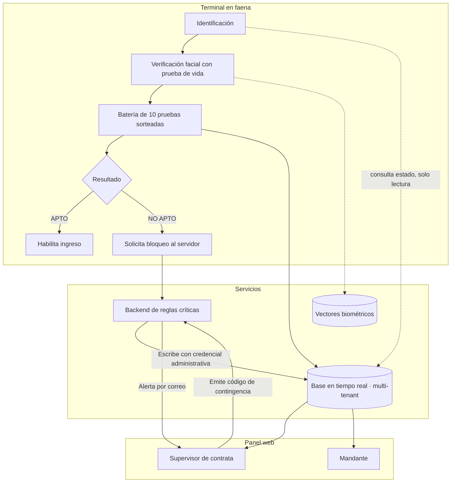

# Cortex — La Secuencia

Plataforma de evaluación de aptitud psicofísica previa al turno para operadores de
maquinaria pesada en faena minera.

| | |
|---|---|
| **Integrante** | <TU NOMBRE> |
| **Rol en el proyecto** | <QUÉ HICISTE TÚ: análisis, arquitectura, desarrollo, reglas de seguridad> |
| **Contexto** | Cliente real · Operación minera |
| **Estado** | **En producción.** Operación diaria con ~25 operadores en dos turnos |
| **Periodo** | Diciembre 2025 — Noviembre 2026 · versión 1.2 |
| **Naturaleza de los datos** | Datos reales de faena. Este documento no publica ninguno |
| **Demo en video** | <PENDIENTE: pegar enlace> |

---

## 1. El problema

Un operador de camión de acarreo que llega fatigado a su turno es un riesgo de accidente
grave o fatal. El control de ingreso en faena se apoyaba en tres cosas insuficientes:

- **Lista de asistencia en papel.** Registra que la persona llegó, no en qué estado.
- **Inspección visual del supervisor.** Depende del criterio de quien esté de turno, de la
  hora y de la relación con el operador. No es reproducible ni defendible ante una
  auditoría.
- **Prueba de alcoholemia aislada.** Detecta una sola causa. No dice nada sobre fatiga
  acumulada, somnolencia ni disminución de reflejos, que son las causas más frecuentes.

Faltaba una medición objetiva del estado psicomotriz antes de entregar el control de una
máquina de decenas de toneladas. Y faltaba el registro: tras un incidente, no había
evidencia de en qué condición ingresó el operador.

El problema no era solo medir. Era **medir de una forma que nadie pudiera manipular y que
sostuviera un peritaje**.

---

## 2. El análisis

El trabajo partió de una pregunta incómoda: si el resultado bloquea a alguien de trabajar
un día completo, ¿qué hará esa persona para evitarlo? El diseño se construyó desde los
incentivos reales del usuario, no desde el caso feliz.

De ahí salieron las restricciones que definieron todo:

- **El operador tiene motivo para burlar el sistema.** Un NO APTO cuesta un día de
  jornal. Cualquier control que dependa del dispositivo del operador es vulnerable.
- **La mina no tiene cobertura.** En tajo e interior no hay red. El sistema no puede
  exigir conexión, pero tampoco puede confiar en un equipo desconectado.
- **El resultado tiene consecuencia laboral.** Un NO APTO puede terminar en reclamo. La
  prueba debe ser demostrablemente equitativa entre operadores.
- **Hay varias empresas en la misma faena.** Contratistas distintas no pueden ver los
  datos de las demás.
- **El tiempo de turno es escaso.** La evaluación compite con la producción: diez pruebas
  en menos de cuatro minutos.

**Herramientas y metodologías aplicadas**

| Herramienta / método | Para qué la usé |
|---|---|
| Modelado de amenazas desde el incentivo del usuario | Derivar los controles antifraude del motivo real para evadirlos |
| Diseño de reglas de autorización por rol | Separar lo que el cliente puede escribir de lo que solo el servidor decide |
| Arquitectura multi-tenant | Aislar los datos de cada contratista en la misma faena |
| Diseño para operación sin conectividad | Permitir evaluar en tajo sin abrir una puerta al fraude |
| Simulación Monte Carlo | Verificar que el sorteo de pruebas es equitativo |
| Pruebas unitarias sobre reglas de decisión | Dejar las reglas de seguridad verificables, no solo documentadas |

---

## 3. La solución

**Propuesta de valor:** para una operación minera que debe garantizar que nadie opere
maquinaria pesada en mal estado, esto entrega una medición objetiva en menos de cuatro
minutos, con registro inalterable y trazabilidad por contratista — a diferencia de la
inspección visual, que no es reproducible, y del control de alcoholemia, que mide una sola
causa.

El operador se identifica con verificación facial con prueba de vida, rinde diez pruebas
cognitivas sorteadas y recibe APTO o NO APTO. El supervisor ve los resultados de su guardia
en tiempo real. El mandante audita la faena completa.

### Arquitectura

### Decisiones de diseño con razón de negocio

**El bloqueo lo escribe el servidor; el cliente solo lee.** Cuando un operador resulta NO
APTO, la inhabilitación de 24 horas se escribe desde el backend con credencial
administrativa. Las reglas de base de datos dejan ese nodo en solo lectura para la app.
*Evita que el operador se habilite borrando la caché de la aplicación desde los ajustes del
teléfono.* El control vive donde el usuario no alcanza.

**Doble verificación al iniciar sesión.** La app consulta tanto el nodo oficial de bloqueos
como el de solicitudes pendientes generado al momento de reprobar. *Si el backend se cayó
justo después de la evaluación, el operador no queda habilitado por el hueco.*

**Token de gracia anclado al hardware, no al reloj del sistema.** Para operar sin
cobertura, la validez se ata al reloj monótono del dispositivo y al identificador de
arranque del kernel, con ventana de 12 horas. *Cambiar la fecha del teléfono o apagarlo
para congelar el tiempo no extiende la gracia.* Resuelve la falta de red sin abrir la
puerta al fraude más obvio.

**Código de desbloqueo atado al dispositivo que lo pidió.** El código de seis dígitos que
emite el supervisor solo se canjea en el equipo físico que originó la solicitud. *Evita que
el código circule entre compañeros o se use desde un teléfono particular.*

**Anulación retroactiva de sesiones offline.** Al recuperar conexión, si una evaluación
offline se ejecutó mientras había una inhabilitación vigente en el servidor, la sesión se
anula, la terminal se bloquea y el supervisor recibe una alerta. *Elimina el incentivo de
desconectar el equipo deliberadamente para entrar a trabajar inhabilitado.*

**Sorteo balanceado con simetría garantizada.** El selector reparte las diez pruebas
distribuyendo uniformemente velocidades y exigencia cognitiva. *Un NO APTO no puede
atribuirse a que le tocó una batería más difícil.* Es una decisión jurídica antes que
técnica: blinda el resultado frente a un reclamo laboral.

**Papelera lógica en lugar de borrado.** Excluir un registro del panel cambia un estado,
no elimina el documento. *Preserva la evidencia ante peritajes o auditoría del regulador
de seguridad minera.*

**Modo sombra para mediciones fisiológicas.** Las capturas experimentales de pulso por
cámara se guardan solo como telemetría técnica y no intervienen en el cálculo de aptitud.
*Impide que un algoritmo en calibración detenga a un operador por un falso positivo, y
evita usar métricas de salud no homologadas en una decisión laboral.*

**Aislamiento por contratista en las reglas, no en la aplicación.** Cada empresa accede
solo a su rama, gobernado por atributos del token. *Una falla de la interfaz no expone los
datos de otra contratista.*

---

## 4. Indicadores y resultados

### Operación real

| Indicador | Valor |
|---|---|
| Estado | En producción, operación diaria |
| Operadores evaluados por día | ~25, en dos turnos |
| Duración de la evaluación | Menos de 4 minutos, 10 pruebas |
| Versión en faena | 1.2 |
| Periodo de desarrollo y operación | Dic 2025 — Nov 2026 |

### Calidad verificable

| Indicador | Valor |
|---|---|
| Pruebas automatizadas | **305**, todas en verde (243 móvil · 62 panel web) |
| Commits | 175 |
| Líneas de código | 38.793 (28.115 móvil · 5.545 backend · 5.133 panel) |
| Pantallas | 28 (22 móvil · 6 panel) |
| Endpoints de backend | 11 |

Las pruebas no cubren solo cálculo: cubren las **reglas de decisión de seguridad** —
matriz de acceso y borrado de caché, validación del token de gracia contra manipulación de
reloj y reinicio, detección de fraude y anulación retroactiva, consistencia de reintentos,
balance del sorteo por Monte Carlo. Las reglas antifraude descritas arriba están
verificadas, no solo documentadas.

### Observabilidad

El backend expone un endpoint de salud con tiempo de actividad, verificación de conexión a
base de datos y consumo de memoria, con monitoreo externo que alerta ante caída o latencia
sobre 30 segundos. Las decisiones de seguridad fallan cerradas; la telemetría secundaria
falla abierta y no interrumpe la operación.

---

## 5. Limitaciones y qué haría distinto

- **Alta manual de contratistas.** El aislamiento estricto en la raíz de la base impide
  listar empresas desde el cliente, así que incorporar una nueva exige registrarla a mano.
  Es el costo aceptado del modelo de seguridad; con más clientes, necesita un servicio de
  catálogo dedicado.
- **Escritura dual por compatibilidad.** Conviven escrituras hacia el esquema anterior para
  no romper terminales sin actualizar. Es deuda consciente, con fecha de retiro pendiente.
- **La bandeja de solicitudes no guarda historial.** Solo persiste la más reciente por
  operador. Reconstruir una auditoría de varias solicitudes exige ir a la telemetría
  profunda. Lo rediseñaría como evento, no como estado.
- **Expiración diferida en el cliente móvil.** El cambio formal de pendiente a expirado
  ocurre cuando un supervisor abre el panel. El panel web ya lo resuelve en memoria; la app
  no.
- **Dependencia de hardware heterogéneo.** Las pruebas con vibración, audio de baja
  latencia y control de exposición de cámara exigen homologar cada modelo nuevo antes de
  llevarlo a faena.

---

## 6. Demo

<PENDIENTE: enlace al video>

## 7. Capturas

<PENDIENTE: el repositorio no contiene capturas de la interfaz operativa. Tomar capturas
del panel y de la app, sin datos reales de operadores, y agregarlas en `capturas/`>

---

## Nota sobre el contenido publicado

Este documento describe arquitectura y decisiones de diseño. No incluye credenciales,
endpoints, identificadores de proyecto, reglas de seguridad en su forma literal, ni el
nombre de la faena, el contratista o los operadores. Las capturas que se agreguen no deben
mostrar datos reales de personas.
