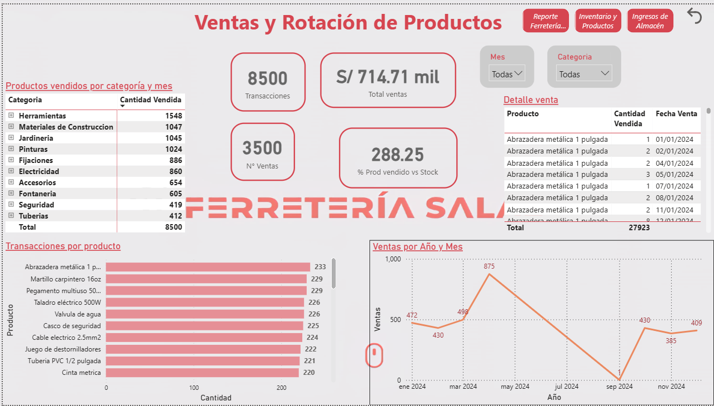
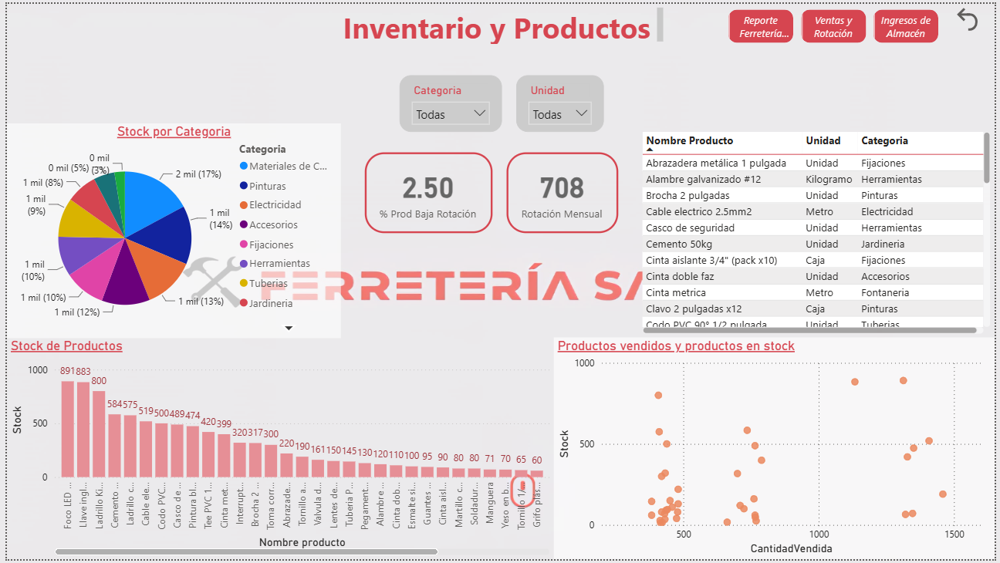
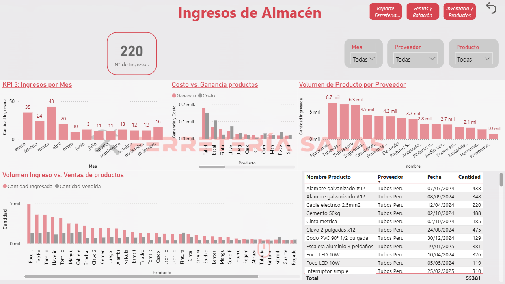

# Dashboard de inteligencia de negocios — Ferretería Salas

Modelo de datos y tablero analítico para el proceso de ingreso de productos y la rotación
de inventario de una ferretería.

| | |
|---|---|
| **Integrante** | Tirza Buendía González |
| **Rol en el proyecto** | Proyecto individual: diseño del esquema, generación de datos, definición de KPIs, limpieza y construcción del tablero |
| **Contexto** | Proyecto de tesis · trabajo individual |
| **Naturaleza de los datos** | **Sintéticos**, generados a partir del esquema diseñado |
| **Entregable** | [Carpeta del proyecto, con video de demostración](https://drive.google.com/drive/folders/1uiERyUe1m4T0LvR-3WR8qGOtvRlHc_g6?usp=drive_link) |

> **Sobre los datos.** Todo el conjunto es sintético. Los hallazgos que aparecen más abajo
> describen el comportamiento del modelo, no el de un negocio real. Lo que esta evidencia
> demuestra es el método completo —del esquema a la recomendación—, no un diagnóstico
> comercial verificado.

---

## 1. El problema

Una ferretería maneja cientos de referencias en categorías con comportamientos de demanda
muy distintos: herramientas, materiales de construcción, pinturas, tuberías, jardinería,
seguridad. El ingreso de productos al almacén se decide por costumbre y por disponibilidad
del proveedor, no por lo que la demanda muestra.

El costo de esa decisión no es visible en la caja diaria, sino en el inventario:

- **Capital inmovilizado.** Productos de baja rotación ocupan espacio y dinero que no
  vuelve a circular.
- **Estacionalidad no aprovechada.** Si la demanda se concentra en ciertos meses, comprar
  parejo todo el año garantiza faltante en temporada alta y exceso en temporada baja.
- **Categorías sin evaluar.** Sin medición, una categoría que aporta poco ingreso recibe
  el mismo esfuerzo de abastecimiento que una rentable.
- **Proveedores sin jerarquía.** No se sabe cuáles concentran el volumen y, por lo tanto,
  con cuáles conviene negociar.

Antes de responder cualquiera de estas preguntas hace falta algo que la ferretería no
tenía: **un modelo de datos que permita formularlas**.

---

## 2. El análisis

El trabajo siguió seis pasos, en orden:

1. **Diseño del esquema de base de datos.** Ocho tablas relacionadas, con *Productos* como
   entidad central, cubriendo ventas, inventario, ingresos de almacén y proveedores.
2. **Generación de datos sintéticos coherentes con el esquema.** No valores aleatorios:
   volúmenes, estacionalidad y relaciones plausibles para un negocio de este tipo.
3. **Definición de objetivos y KPIs** antes de construir el tablero, para que cada visual
   respondiera a una pregunta de negocio y no al revés.
4. **Limpieza de datos.**
5. **Construcción del tablero** en tres hojas: ventas y rotación, inventario y productos,
   ingresos de almacén.
6. **Lectura de resultados y formulación de recomendaciones.**

Definir los KPIs antes del tablero es la decisión que ordena todo el proyecto. Es la
diferencia entre un panel que muestra lo que la herramienta sabe graficar y uno que
responde lo que el dueño necesita decidir.

**Herramientas y metodologías aplicadas**

| Herramienta / método | Para qué se usó |
|---|---|
| SQL Server | Esquema relacional de ocho tablas y consultas de análisis |
| Excel | Generación y preparación del conjunto sintético |
| Power BI | Construcción del tablero de tres hojas |
| Google Docs | Documentación del proyecto y definición de objetivos |
| Modelado dimensional | Estructurar el esquema alrededor de la entidad Productos |
| Definición de KPIs previa al tablero | Que cada visual responda a una pregunta de decisión |

---

## 3. La solución

**Propuesta de valor:** para un negocio que decide qué comprar por costumbre, esto
convierte el historial de ventas e ingresos en cuatro indicadores de abastecimiento — a
diferencia de un reporte de ventas, que dice qué pasó pero no qué comprar el mes que
viene.

### Indicadores definidos

| KPI | Qué decisión informa |
|---|---|
| Porcentaje de productos vendidos sobre stock disponible | Si el inventario está dimensionado a la demanda |
| Productos ingresados al almacén por mes | Si el abastecimiento sigue el calendario de demanda |
| Rotación mensual por producto | Qué referencias mueven capital y cuáles lo retienen |
| Porcentaje de productos de baja rotación | Cuánto del catálogo no se está pagando a sí mismo |

### El tablero

Tres hojas, cada una con una pregunta propia:

- **Ventas y rotación.** Qué se vende, cuándo y a qué ritmo.
- **Inventario y productos.** Qué hay en stock y cuánto de eso no se mueve.
- **Ingresos de almacén.** Qué entra, de qué proveedor y en qué volumen.

---

## 4. Resultados

### Lo que el modelo muestra

Sobre el conjunto sintético, el análisis identifica patrones de los cuatro tipos que los
KPIs fueron diseñados para detectar:

| Hallazgo | Tipo de patrón |
|---|---|
| El 65 % de las ventas anuales se concentra en el primer cuatrimestre | Estacionalidad |
| Entre julio y septiembre caen las ventas y sube el exceso de stock | Desalineación entre compra y demanda |
| Cuatro categorías concentran el 45 % de los ingresos; dos aportan solo el 9 % | Asignación de recursos por categoría |
| Referencias puntuales acumulan stock sin rotación | Capital inmovilizado identificable |
| Tres proveedores dominan el volumen de ingresos | Concentración de proveedores |

### Recomendaciones derivadas

1. Ajustar el plan de abastecimiento al calendario de demanda en lugar de comprar parejo.
2. Reducir el volumen de ingreso de las referencias de baja rotación.
3. Aumentar la adquisición en las categorías con presencia real en ventas.
4. Mantener el catálogo, ajustando cantidades por producto en lugar de eliminar
   referencias.
5. Negociar condiciones con los proveedores que concentran el volumen.

Las recomendaciones no son una lista de observaciones: cada una se desprende de un KPI
concreto y nombra una acción de abastecimiento.

---

## 5. Limitaciones

- **Los hallazgos son del modelo, no del negocio.** Los datos son sintéticos. Que el 65 %
  de las ventas caiga en el primer cuatrimestre describe el conjunto generado; validarlo
  exigiría el historial real de la ferretería.
- **Lo que sí queda demostrado es el método.** Esquema, generación coherente, KPIs
  definidos antes del tablero, limpieza, visualización y recomendación accionable. Ese
  encadenamiento es transferible a cualquier conjunto real.
- **Sin ciclo de validación.** Las recomendaciones no se aplicaron ni se midió su efecto.
  Es análisis, no intervención.
- **Alcance de un solo periodo.** El modelo no contempla variación entre años ni efectos
  de precio sobre la demanda.

---

## 6. Material del proyecto

[Carpeta del proyecto](https://drive.google.com/drive/folders/1uiERyUe1m4T0LvR-3WR8qGOtvRlHc_g6?usp=drive_link) — tablero en formato
`.pbix`, conjunto de datos en Excel, diagrama del esquema relacional, documentación y un
video de demostración del tablero.

## 7. Capturas

### Hoja 1 — Ventas y rotación de productos

*8.500 unidades vendidas en 3.500 transacciones. La serie mensual es el hallazgo que
ordena todas las recomendaciones: pico en marzo, caída sostenida hasta un mínimo en
septiembre y recuperación en noviembre. Si la compra es pareja todo el año, esa curva es
dinero inmovilizado medio año. Los filtros por mes y categoría permiten bajar de la
tendencia general al producto concreto.*

### Hoja 2 — Inventario y productos

*La dispersión de abajo a la derecha es la visual más útil del tablero: cruza unidades
vendidas contra stock, de modo que cada punto arriba y a la izquierda es un producto que
ocupa capital sin moverse. El gráfico de barras lo nombra — foco LED, llave inglesa y
ladrillo encabezan el stock acumulado. Pasa de un indicador agregado a una lista de
compras que corregir.*

### Hoja 3 — Ingresos de almacén

*Aquí se confronta el abastecimiento con la demanda. "Volumen de ingreso frente a ventas"
muestra, producto por producto, cuánto entró y cuánto salió: la brecha es el exceso. El
volumen por proveedor identifica a los tres que concentran los ingresos, que son con
quienes tiene sentido negociar condiciones.*
